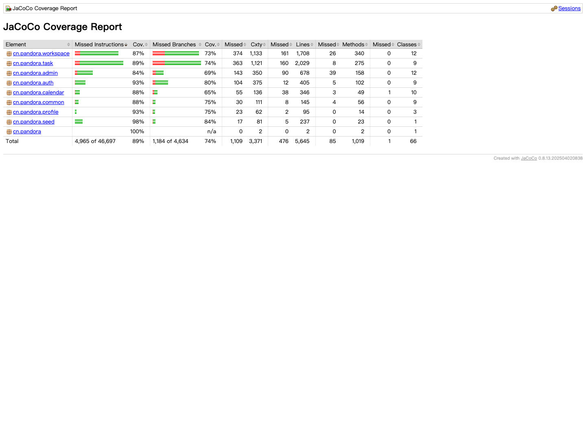
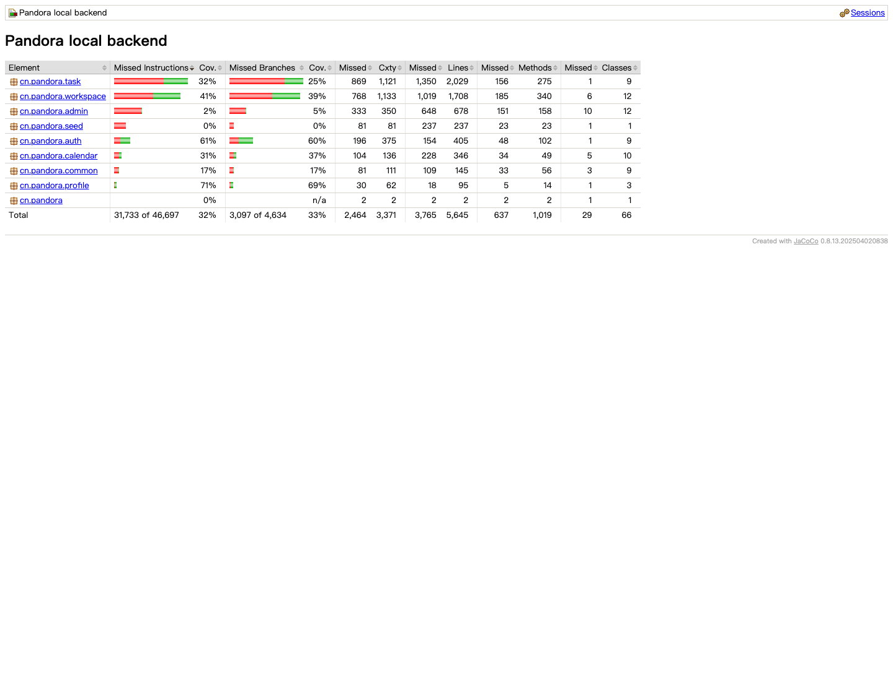

# Pandora 项目综合测试报告

**最终复测版 · 2026 年 11 月 19 日**

测试阶段：2026-11-18 至 2026-11-19；包含缺陷发现、修复、回归、服务器发布、真机安装与重启后检查。时间以北京时间说明。

报告对象：Pandora 后端、网页员工端与管理端、Flutter 安卓员工端及原生安卓客户端。报告依据用户提供的《Week09-单元测试.pdf》《中期验收要求.pdf》和本项目实际代码、测试结果及部署证据编写。

团队名称：________　组员：________　人工复核人：________　复核日期：________

> 本报告记录已执行的测试及其结果。组员姓名、人工逐条审核意见和验收签字留空，由小组据实填写。报告中的详细用例说明卡是已执行用例的阅读索引，不额外增加用例数量。

## 目录

1. 测试结论与验收要求对应
2. 测试对象、环境与版本
3. 测试组织、数据准备和执行流程
4. 详细测试方法
5. 核心业务的正常、边界、异常设计矩阵
6. 代表性用例的完整操作与判定方法
7. 执行结果、重跑与缺陷闭环
8. 覆盖率与截图
9. 部署、数据一致性、手机与重启验证
10. 局限、人工复核和验收安排
11. 复现操作与证据索引
12. 附录：提示词、审核表与统计定义

## 1. 测试结论与验收要求对应

### 1.1 最终结论

此前综合测试确认的 **9 类缺陷已完成修复和针对性复测**。最终实际执行的框架用例共 **674 条，全部通过**；另有 **41 套业务回归全部通过**，这些套件最终日志合计记录 **3105 条通过断言**；独立测试包的 **16 项真机检查全部通过**。

三种数量分别表示框架用例、套件内可观察断言、设备检查，存在行为覆盖重叠，不能相加当作不同业务场景数量。逐项结果表共有 3795 条记录，计算为 674 条框架用例 + 3105 条打印断言 + 16 项设备检查，表中明确标明各自层次。

最终版本已分别部署至 443 与 Flutter 使用的 6644 两套服务，两者保持各自数据。两个 HTTPS 入口健康检查均通过，线上每日事项脚本与修复版一致。Flutter 修复版已覆盖安装到连接手机；最终线上启动观察到已登录任务看板，无连接错误提示。用户随后重启服务器，复查数据库及两套应用均自动启动，并仍运行修复版。

本轮自动化范围的结论为“修复后回归通过”。这不替代课程要求的小组人工逐条复核，也不证明系统在所有设备、负载和输入组合下都无缺陷。

### 1.2 验收资料对应关系

| 参考要求 | 本报告的落实方式 | 状态 |
|---|---|---|
| 聚焦后端核心业务 | JUnit 225 条、pytest 真实接口 139 条，以及组织、审批、任务、日志、权限和迁移回归 | 已执行 |
| 等价类划分、边界值分析 | 第 4 节说明划分类别、边界依据与取值；第 5、6 节给出具体设计与断言 | 已落实 |
| 核心函数 / 方法至少三条，覆盖正常、边界、异常 | 业务 / 方法组设计矩阵、逐项结果及逐方法覆盖与复核表 | 需小组逐方法确认范围及对应关系；不能仅凭覆盖率认证 |
| JUnit、pytest 等框架 | 使用 JUnit、pytest、Flutter test，原始 XML / JSON 结果随附 | 已执行 |
| 测试过程、设计、结论 | 第 3–7 节，保留首轮失败、工具异常与最终重跑 | 已编写 |
| 覆盖率与截图 | 第 8 节给出当前修复版 JaCoCo、Flutter LCOV 及可视化截图 | 已提供 |
| 提示词附录 | 附录记录实际用户请求及明确标记的复用设计模板 | 已提供 |
| AI 生成用例人工逐条复核 | 提供输入、目的、预期和证据索引及签字表 | 待组员复核，不虚构已审核 |
| 验收前放入共享文件夹 | 交付离线报告与证据包 | 尚未代为上传小组共享目录 |

《Week09-单元测试.pdf》第 7–13 页用于框架与断言选择，第 24–28 页用于区分行、分支、方法等覆盖指标。《中期验收要求.pdf》第 1 页用于报告结构与三类用例设计。文件校验值保存在 `evidence/initial-reference-documents.json`。

## 2. 测试对象、环境与版本

### 2.1 版本范围

测试以主分支提交 `7a51c0121794e7561f8524308cc582d78e01a782` 的本地工作区为基础，包含此前已完成的 Flutter 界面及 6644 地址修改，以及本轮 9 类缺陷修复。Git 修改尚未自动提交或推送，因此不能把基线提交号单独当作最终二进制的完整标识。

最终后端 JAR 的 SHA-256 为：

`f3182ca996f6b759b6c123a299dd2badee479e1eaa3d3fe071df32bf1e07889b`

最终 Flutter APK 的 SHA-256 为：

`1d6b70d59d96b88371d42b4d3f46e042708e041b0baf38a1a2bb47bae0e7f3cf`

修复前后证据分开保留。旧报告中的失败不应继续当成当前未修复项，也不能从历史日志目录简单累加得到最终数量。

### 2.2 环境

| 层次 | 实际环境与用途 |
|---|---|
| 主机 | macOS / Apple Silicon，中文路径工作区 |
| 后端 | JDK 23 运行工具链，Java 21 编译目标；Maven 3.9.9 |
| 本地数据库 | MySQL 9.3，本机端口 13306；使用随机隔离库 |
| 服务器数据库 | 独立 MySQL 8.4，回环端口 13316；与本地版本不同，另做真实数据副本升级与启动核验 |
| Flutter | Flutter 3.47.9、Dart 3.13.7；ARM64 debug 构建 |
| 原生安卓 | Gradle 8.13、AGP 8.13.2；JVM 单元、lint、assemble |
| 浏览器 | 实际 Microsoft Edge，自动操作 DOM、鼠标、键盘和触摸；不是只读取静态源文件 |
| 真机 | 荣耀 MGI_AN00，Android 15；折叠设备，测试时使用 1080×2560 外屏 |
| 覆盖率 | JaCoCo 0.8.13；Flutter 生成 LCOV |
| 最终线上入口 | `https://8.141.96.122:6644/` 为 Flutter 对应实例；443 为另一独立实例 |

### 2.3 角色与数据

API 夹具创建两个组织作为授权对照。主组织有创始人、两个部门的负责人、四个小组负责人及各组员工，并有独立管理员；另一个组织提供异公司创始人与管理员。身份按实际组织位置构造，不靠职位名称猜测权限。

Flutter 真实服务及手机使用独立演示夹具，包含员工、组长、部门负责人、创始人四种登录身份。固定测试凭据仅用于隔离夹具，不使用服务器真实员工密码。

模拟数据采用唯一 UUID / 幂等键和清晰测试前缀。长字符串用重复规则描述，例如“汉 × 2001”，避免用例表充斥数千字符。数据文件中的邮箱域名 `example.test` 是测试输入，用于格式边界，不表示发送邮件或实际收信测试。

## 3. 测试组织、数据准备和执行流程

### 3.1 进入条件

开始执行前检查当前工作区改动、构建依赖、数据库可用性、已连接设备及临时服务端口。保留用户既有改动和历史 stash。后端必须由当前源码重新构建，避免旧 JAR 与新源代码混测。

真实接口夹具先创建自己的随机 `pandora_precheck_*` 库，执行当前迁移并写入角色 / 任务等数据，再启动仅监听本机的临时服务。若待用的正式演示端口或手机专用转发已被占用，工具拒绝直接覆盖。

### 3.2 执行顺序

1. 阅读两份资料和当前需求，列出业务范围、长度 / 日期 / 权限约束。
2. 运行修复前基线，增加边界与跨端一致性用例，记录失败输入与实际表现。
3. 按实现、需求和独立证据区分产品缺陷、过时测试预期、环境故障。
4. 修复 F01–F09，保留原失败用例，不通过删除负例或放宽断言制造全绿。
5. 后端执行 clean 构建和 JUnit，Flutter 执行单元 / 组件测试，pytest 访问新 JAR 启动的真实服务。
6. 执行 41 套业务 / 浏览器 / 迁移回归；对浏览器通信超时和登录等待失败单独重跑，保留首轮日志。
7. 用真实后端运行 Flutter 管理联动和员工业务测试；使用独立 `.qa` 包执行手机流程。
8. 生成正式 debug APK，安装至手机原包名，保留本地账号数据。
9. 分别备份两套线上数据，恢复至新库，验证升级和记录数后切换；核对 HTTPS、脚本字节和手机启动。
10. 用户重启服务器后，再检查服务自启、修复版路径及 HTTPS 健康状态。

### 3.3 判定与退出规则

单元测试须断言返回值、异常类型或错误码；API 测试不能只看服务存活，需检查状态码和相应业务结果。关键写入使用读回、行版本或 SQL 计数作为第二个判定点。浏览器用例检查可见控件、真实数据、草稿保持、错误提示和浏览器异常；真机检查明确前台包名，避免误操作其他应用。

失败用例必须留下结果和证据。相互独立的已知导航失败允许继续记录其余场景，但最终套件仍返回失败；依赖前提不成立的场景不盲目继续。工具重跑的最终通过不能抹掉首轮的不稳定记录。

### 3.4 数据隔离与清理

接口测试的写入发生在随机隔离库，夹具结束后停止自己的进程并删除自己的数据库。真机测试包与原应用使用不同包名；测试完成后卸载 `.qa` 包，移除本轮专用转发。独立手机测试前后原应用 APK 相同；正式安装步骤随后有意更新原应用，另以新 APK 指纹核对。

综合测试前后的常用本地库曾做 21 张表内容指纹比较，结果一致。本轮线上部署使用两套各自的新库，保留各自旧库及受限 SQL 备份，没有把两个入口混到同一份数据。

## 4. 详细测试方法

### 4.1 单元测试：隔离规则、直接断言

**目的：** 在不依赖浏览器和实际 HTTP 的条件下，定位文本、日期、密码、版本和时钟等规则错误。

**实施：** 使用 JUnit 参数化测试 `@ValueSource`、`@CsvSource`、`@MethodSource`、空值输入及重复测试。纯校验方法直接调用；已有业务单元测试按各自设计使用受控依赖。对正常输入使用 `assertEquals` / `assertDoesNotThrow`；异常输入同时核对异常类型、HTTP 语义状态或业务错误码，避免“抛了任何异常就算通过”。

**实例：** `Writes.checkVersion` 对正确强 ETag 接受；缺失返回 428 / PRECONDITION_REQUIRED；弱 ETag、旧版本及格式错误返回 412 / VERSION_CONFLICT。时钟测试先设置确定的基准瞬时，推进后调用 `withZone`，比较转换前后 `instant`，同时核对时区。该测试捕获了原实现丢失 offset 的问题。

**判定边界：** 单元命中并不表示数据库事务、认证过滤器或浏览器提交也正确，因此同一规则还会在 API 或组件层复核。

### 4.2 等价类划分：先分类型，再选代表值

**划分原则：** 同一约束下预计有相同行为的一组输入归为一类，每类至少选代表。有效类和无效类分开；类型、范围、权限、状态不混成一个负例。尽量一次只改变一个因素，避免多个错误互相遮盖。

| 对象 | 有效类代表 | 无效类代表 | 判定依据 |
|---|---|---|---|
| 登录字段 | employee + 手机号 + 字符串密码 | 未知 accountType、缺身份、密码数字、手机号数组、多个冲突身份键 | 类型 / 结构异常 400；空凭据身份失败 401，按现行契约区分 |
| 手机号码 | 纯数字、单个前导 +、允许的显示分隔符 | 过短 / 过长、全角数字、阿拉伯数字、换行、多个 + | 服务端 PhoneNumbers 与 Flutter 同口径 |
| 评论正文 | 字符串及有效空白清理后内容 | Number、Boolean、List、Map、空串、纯空白 | JSON 类型必须是文本；空内容不得创建 |
| 头像 | 可真实解码的 PNG，尺寸在范围内 | 0 像素声明、宽 / 高首次超限 | 实际解码与像素限制，不只检查后缀 |
| 对象访问 | 本人 / 当前授权链 | 同级、异公司、权限收回、非业务管理员 | 依据对象权限返回 403 / 404，避免泄露对象存在性 |

**实施步骤：** 读出接口类型与规则 → 列出有效 / 无效类 → 构造独立参数 → 执行 → 对照预期 → 对可写对象读回或检查状态。139 条 pytest 用例的输入、预期及目的保存在附表中。

### 4.3 边界值分析：精确边界与首次越界

对闭区间 `[L,U]` 优先选择 `L−1、L、L+1、U−1、U、U+1`，再按业务去除没有意义的值或补充分数、溢出等输入。不能仅测试一个“很长”字符串，因为它无法证明最大值恰好被接受。

| 约束 | 本轮关键取值 | 为什么这样选 |
|---|---|---|
| 任务标题最多 80 码点 | 0、1、79、80、81 个 emoji | 空值、下界、上界相邻与首次越界；同时区分码点与 UTF-16 |
| 每日事项正文 1–2000 码点 | 0、1、1999、2000、2001 个汉字 | 精确两端和首次超界 |
| 日志 / 评论最多 10000 UTF-16 单元 | 9999、10000、10001 个 ASCII；5000 / 5001 emoji | 验证补充平面字符占两个 UTF-16 单元 |
| 密码至少 10 码点且最多 72 UTF-8 字节 | 9 / 10 码点；72 / 73 字节；中英文和 emoji 混合 | 最小字符数与最大字节数是两个独立约束 |
| 负责人数量 1–100 | 0、1、99、100、101、1000 | 精确边界与大幅越界 |
| 头像尺寸 | 1、512、513；宽高分别越界及 0 | 防止只校验某一个维度 |
| 邮箱本地部分 | 64 / 65；前导点、连续点、缺域名层级 | 上界及语法等价类 |
| 分页条数 | 0、1、100、101、负数、x、整型极大值 | 上下界、解析异常与溢出倾向 |
| 每日汇总含首尾区间 | 1、92、93、94 天 | 证明 93 天上界是含首尾计数 |
| 时钟推进 | 0、400 天、400 天 +1 秒、负数、小数、2^64 | 先做精度校验再转换，防止截断 / 溢出 |

**长度口径：** “a1 + 7 个 😀”为 9 个码点、16 个 UTF-16 单元、30 个 UTF-8 字节；“汉 × 9 + 1”为 10 个码点、28 字节。分别建立前后端测试，不能用一种长度函数代替所有规则。

### 4.4 日期、时间与精度测试

将普通日期、世纪闰年、普通闰年、非闰年、非法月日、倒序区间、跨年和无时区时间分开测试。使用 2000-02-29、2024-02-29 作为有效闰日，1900-02-29、2026-02-29、2026-04-31 作为无效值；年份测试 1000 / 9998 及外侧 0999 / 9999。

带时区时间戳先按时区转为同一瞬时，再截断至数据库微秒精度；用含 9 位小数的样本核对是向下截断而非四舍五入。日历业务测试同时覆盖跨日、零时长、24:00 截止、跨月 / 跨年、同一时段多个任务。

受控时钟只用于隔离服务，推进不修改操作系统时间。前后时区一致性、推进与 reset 分别验证。未测试所有时区和夏令时组合，不据这些样本宣称全球时区完整兼容。

### 4.5 角色权限矩阵与撤权测试

**矩阵维度：** 行为主体 × 所属公司 × 当前上下级关系 × 对象类型 × 操作 × 当前状态。独立管理员与创始人分开，职位名称与实际组织位置分开。

**方法：** 先由有权角色创建并确认对象存在；使用同一对象 ID 切换角色发起请求；比较允许 / 拒绝结果；调整组织或对象参与者后再次访问，检验旧权限是否撤销。目录摘要、详情和历史通知分别检查，防止仅入口按钮隐藏而 API 仍可读。

**实例：** 本人的每日事项可读，其他员工及异公司创始人读取 404，非业务管理员读取 403；公司信息可供本公司业务角色读取但不可维护；独立管理接口对创始人、部门负责人、普通员工均 403。资料目录不包含隐私字段，实际新管理链可读受授权详情，旧经理调岗后失权。

**判定：** 不只判断状态码，也检查摘要中是否含不应公开的字段，以及失权后旧缓存 / 结果是否还能被读取。这里验证的是具体用例下的权限约束，不等于完整渗透测试。

### 4.6 状态迁移与事务一致性测试

将审批、任务、日志和通知画成可观察的状态序列，而非只测试单个按钮。例如“创建申请 → 冻结有效任务变更 → 当前审核人批准 / 驳回 → 生效 / 保留原版本 → 冻结解除”。每一步检查当前版本、任务参与者、可执行操作和通知等关联结果。

日志序列为“当日新增 → 昨天补填 → 前天补填 → 三天都存在 → 再点新增提示已写全 → 显式编辑仍修改同一条”。并发重复创建时要求保留另一会话原记录和当前未提交草稿，不偷偷进入编辑模式。

组织计划序列包含新员工、职位与负责人调整、离职接管、申请人和业务接管主体区分。非法最终草稿应整体拒绝，不得半套组织落库。通知包括事件投递、已读、撤回、删除评论后安全摘要、严格 180 秒窗口和关联对象失权。

### 4.7 幂等、乐观锁与并发一致性测试

**幂等：** 固定一个 Idempotency-Key，第一次创建保存返回 ID；相同正文和键重放返回同一 ID；相同键改变正文返回 409；再通过 SQL 检查该对象仍只有一行。

**并发重复写：** 使用 `ThreadPoolExecutor(max_workers=8)` 调度 8 个同键同正文创建请求。等全部结束后，断言所有状态为 200 / 201、返回 ID 集合大小为 1，并查询对应 `daily_item.created` 事件只产生一次。这里是并发调度，不声称有严格同时起跑的屏障。

**旧版本竞争：** 两个线程以同一 rowVersion=1、不同键和不同正文更新同一事项，期望状态集合恰为 `[200,412]`，最终行版本为 2。若两次均成功或版本变为 3，则判失败。

这些用例验证有限并发下的数据一致性，不是容量压测；未依据 8 个线程推导生产 QPS、最大用户数或 P95 延迟承诺。

### 4.8 数据库迁移与数据保全测试

本地用全新库和历史版本逐步升级库比较最终结构，包括列、外键、索引、唯一键和 CHECK 约束；验证旧映射、退役私人标签不能复活，以及旧业务记录升级前后保持。

正式发布时先停止对应应用导出最新 SQL，恢复到新的独立数据库，使用候选服务完成 V36 升级，比较十类关键业务表记录数量，确认启动及健康后再切换。两套服务分别执行，旧库和原始 SQL 备份保留。V36 删除公司信息独立 title 字段是当前需求中的有意结构变化，原值仍在旧库与备份中；不能把该删除当作无差别“所有列相同”的比较前提。

数量一致可以发现明显遗漏，但不能单独证明每一字段内容完全相同。因此报告同时保留备份和迁移步骤，不把行数检查夸大为所有线上字段的逐值校验。

### 4.9 网页与 Flutter 组件测试

网页采用实际浏览器，以真实接口载入隔离数据；等待“页面准备完成且请求空闲”后操作，随后观察 DOM 和数据状态。覆盖 320 / 390 / 1440 像素宽度及短屏；通过真实鼠标、键盘、触摸输入验证长按、拖拽、Esc、表单草稿、嵌套选择器和分页。既检查截图，也检查几何位置、横向溢出、可见范围与浏览器异常。

“今天”回归先定位到 2040-01，离页再返回后点击今天；分别在 390 / 1440 宽度、返回后 0 / 10ms 操作，记录立即状态和延迟 650ms 后状态。两次锚点和可见日期都必须保留目标日，防止迟到布局覆盖用户导航。

Flutter 使用 widget test 设置手机尺寸，输入表单，触发事件，推进测试时间并观察可见内容 / 路由 / 异常。密码与手机号规则做前后端等价输入对照；真实服务测试另外执行，不用组件 mock 替代服务联调。

### 4.10 真机、网络恢复与进程恢复

连接并确认授权手机，在单独 `.qa` 包中运行当前源码，使用专用 USB 转发连接隔离演示库。输入前确认前台包名和焦点，读回手机号确认完整后才提交。折叠手机显式选择亮屏截图，避免截到关闭屏幕。

顺序验证四种角色登录、员工五个页签及日视图；强制结束进程后重新打开，观察会话重新验证；移除专用转发后离线冷启动，要求不展示未经验证的旧敏感任务正文并提供明确重试；恢复转发并点击真正可点击的“重试”按钮，验证同一会话恢复。

正式安装后，再核对安装包 SHA-256 与构建一致，并单独观察线上任务看板 / 连接错误状态。前面的 16 项隔离流程与后面的线上启动不是同一种证据，分开记录。

### 4.11 缺陷复测与分层回归

每个缺陷保留最小复现和自动断言，先确认修复前红、修复后绿，再执行相关功能和全量现行回归。对工具超时单独重跑，保留两份结果；若是业务断言失败，必须先解释并修复，不以重跑次数“多数通过”判合格。

旧测试中私人标签字段、通知下拉框等已退役前提按现行需求适配，记录适配依据。新的负例和边界值不因为会失败而删除。对应的源码 / 测试索引及最终结果列于第 7 节。

## 5. 核心业务的正常、边界、异常设计矩阵

下表是方法组与场景的追踪入口。每行至少明确正常、边界、异常三种设计，但一行可能包含多个方法，不能据此机械认证其中每个方法均已有三条独立单元用例。完整方法覆盖和人工确认栏另列于 `逐方法覆盖与复核.csv`。

| 方法 / 业务组 | 正常 | 边界 | 异常 | 证据入口 |
|---|---|---|---|---|
| 登录 / PhoneNumbers.normalize | 员工正常登录；格式化号码规范化 | 3 / 20 位、+123、+86 (138) 0000.0004 | 2 / 21 位、Unicode 数字、错误字段类型 | TC-01；PhoneBoundaryMatrixTest |
| Credentials.requirePolicy / Flutter PasswordPolicy | 10 码点且含字母数字 | 9 / 10 码点、72 / 73 UTF-8 字节 | 缺字母、缺数字、两端 Unicode 处理不一致 | TC-02；CredentialBoundaryMatrixTest |
| Credentials.generate | 生成 16 位符合策略的密码 | 64 个一批，共三批 | 样本内重复、生成值策略不合格即失败 | CredentialBoundaryMatrixTest |
| Writes.checkVersion | 正确强 ETag | 0 / 1 / Long.MAX_VALUE | 缺失 428、弱 ETag / 旧版本 412 | TC-03；CoreBoundaryMatrixTest |
| Writes.run | 同键同正文重放 | 8 个同键并发写入 | 同键换正文 409、重复副作用 | TC-04、TC-05 |
| TaskService 文本校验 / create | 普通标题与 emoji | 1 / 79 / 80 码点 | 0 / 81 码点、NUL、非文本 | TC-07；TaskGuardBoundaryMatrixTest |
| TaskService.ids | 合法唯一负责人列表 | 1 / 99 / 100 人 | 0 / 101 / 1000 人、无效引用 | TaskGuardBoundaryMatrixTest；业务回归 |
| TaskService 日期 / 时间转换 | 有效日期与带时区瞬时 | 1000 / 9998 年，微秒精度 | 非法闰日、无时区、非补零日期 | TC-09；TaskGuardBoundaryMatrixTest |
| TaskService 审批与生效 | 申请、审核、版本生效 | 组织关系改变与冻结期间 | 旧审核人、旧版本、越权和重复生效 | check_review_routing、check_apply_mixed_edit |
| DailyItemService.create / summary | 本人创建、跨日覆盖 | 1 / 2000 码点，93 天含首尾 | 空内容、2001、94 天、倒序区间 | TC-08、TC-09、TC-10 |
| DailyItemService.detail / change | 本人读写与正确版本更新 | If-Match 缺失、0、1、极大值 | 异公司 / 同级读取，陈旧版本写入 | TC-06、TC-10、TC-11 |
| DailyItemService.list | 指定日列表 | 1 / 100 条，末页与空页 | 0 / 101 / 整型极值、删除后接续 | TC-10；check_daily_items |
| WorkspaceService 日志增改 | 当日写、补填、显式编辑 | 10000 / 10001 UTF-16；冻结临界 | 重复日期、无权读写、冻结后更新 | TC-12；check_log_backfill_entry |
| CommentService.create / change | 普通正文、作者编辑 | 1 / 10000 / 10001，emoji 长度 | Number / Boolean / List / Map、纯空白 | TC-13、TC-14 |
| CommentService.list / delete | 发布顺序读、作者删除 | 分页中删除、已投递后删除 | 非作者、失权、对象 / 评论已删除 | check_fixed_notifications；通信与修复回归 |
| ProfileService.update | 合法邮箱与可解码头像 | 邮箱 64 / 65，PNG 1 / 512 / 513 | 非法语法、0 像素、越权详情 | TC-15、TC-16；资料权限回归 |
| OrganizationPlans / 组织接管 | 完整计划、新增、职责接管 | 负责人 / 职位 / 单位调整 | 非法最终草稿、跨公司、旧版本 | check_organization_plans、check_business_takeover |
| OrganizationService 公司信息 | 管理员增改删排序 | 10 条上限、删除版本前置条件 | 第 11 条、缺 / 错顺序、业务角色写入 | TC-17；check_admin_contract |
| OrganizationService.setOffWorkTime | 18:00 | 00:00 / 23:59:59 | 24:00、23:60、非补零、业务角色写入 | TC-18 |
| WorkspaceService.adminTeams / audit | 管理员分页读 | 1 / 100 条 | 0 / 101 / x；业务角色 403 | TC-19 |
| EventsWorker / 通知 | 投递、已读、安全跳转 | 180 秒窗口、20–120 条分页 | 撤回后敏感内容、冻结提醒、迟到响应 | TC-21；通知与历史权限回归 |
| HolidayCalendar / 缓存刷新 | 读缓存、管理员更新 | 当前年 / 次年、缺失年合并意图 | 坏 payload、上游失败、普通员工刷新 | check_holidays |
| ControllableClock / advanceClock | 推进、重置、换时区 | 0 / 86400 秒、400 天 | 负数、小数、2^64、丢偏移 | TC-20 |
| 网页日历导航 / 拖拽 | 鼠标 / 触摸 / 键盘操作 | 500ms 长按、屏幕边缘、短屏 | Esc、激活前滚动、远月份回今天 | TC-22；check_schedule_drag |
| Flutter 会话 / 页面 | 四角色、五页签、日视图 | 进程结束、离线冷启动 | 未验证旧内容、错误重试定位、会话失效 | TC-23；真实后端 37 条 |
| 迁移 / 发布 / 自启动 | 新旧结构升级、独立切换 | V35→V36、重启后两服务 | 丢记录、串库、旧发布误生效 | TC-24；迁移套件与部署核验 |

### 5.1 逐方法复核的具体做法

先由组员确认哪些是现行业务核心方法，排除 record 构造器、编译器辅助方法和已退役兼容入口；再给每个方法关联至少三条具有不同意图的正常 / 边界 / 异常用例。核对异常是否确实进入该方法，还是在认证过滤器前就被拒绝。随后填写预期、实际、证据路径和审核人。

已有源代码扫描得到 249 个 public 候选，其中包含辅助入口，并不等于 249 个现行核心功能。本轮 JaCoCo 报告列出 1019 个可执行方法（含构造器等）。两种数量口径不同。`逐方法覆盖与复核.csv` 提供实际方法签名、源行和覆盖率，以及待人工确认栏；方法被执行过一次，不能自动转换为三类用例已齐全。

## 6. 代表性用例的完整操作与判定方法

以下 24 张说明卡把实际用例展开为可复核步骤。卡片可能对应多条参数化记录或多个层次测试，卡片数不计入 674。接口路径以 `/api/v1` 为共同前缀，文中省略该前缀；使用的都是隔离测试数据。

### TC-01　登录与手机号的类型 / 格式划分

**采用方法：** 认证、等价类、边界、跨端一致性。

**前置条件：** 启动当前后端的独立角色夹具；准备员工与独立管理员。组件测试使用独立网关与内存会话存储。

**输入 / 数据：** 正常：纯数字、+123、+86 (138) 0000.0004；边界：3 / 20 位；异常：2 / 21 位、全角数字、手机号数组、密码数字、身份类型 root、缺 accountType、混入管理员身份键。

**操作步骤：** ① 直接验证服务端号码规范化值。② 用 Flutter 表单输入相同合法格式并提交。③ 向 /auth/sessions 发送异常结构。④ 分别核对格式规则与认证结果，避免把错误凭据当作格式错误。

**预期与通过判据：** 合法显示分隔符被移除，单个前导 + 保留；非法结构 400；空凭据按认证契约 401。组件能提交合法格式并保留认证失败错误提示。

**最终实际：** 对应最终用例 / 套件通过。

**证据入口：** `PhoneBoundaryMatrixTest；login_page_test.dart；test_login_rejects_invalid_equivalence_classes`；精确用例名见 `逐项测试结果.csv`，其中 evidence 列指向原始记录。

### TC-02　密码的码点、字母范围和字节上限

**采用方法：** 边界、等价类、跨端对照。

**前置条件：** 使用服务端 Credentials.requirePolicy 与 Flutter PasswordPolicy 的独立测试，不需要真实用户密码。

**输入 / 数据：** Abcdefghi1；a×71 + 1（72 字节）；a×72 + 1（73 字节）；汉×9 + 1（10 码点）；a1 + 😀×7（9 码点但 16 UTF-16 单元）。

**操作步骤：** ① 计算每个样本的码点与 UTF-8 长度。② 对正常与上界值分别调用两端策略。③ 对首次越界、缺字母 / 数字输入调用策略。④ 对比两端接受 / 拒绝结论。

**预期与通过判据：** 72 字节且符合最小码点规则的密码接受；73 字节、9 码点、缺类别均拒绝；中文样本两端一致接受。

**最终实际：** 对应最终用例 / 套件通过。

**证据入口：** `CredentialBoundaryMatrixTest；acceptance_boundary_test.dart`；精确用例名见 `逐项测试结果.csv`，其中 evidence 列指向原始记录。

### TC-03　ETag 前置条件与乐观锁

**采用方法：** 单元、边界、异常语义。

**前置条件：** 准备 rowVersion=1；纯方法测试无需 HTTP。

**输入 / 数据：** 正确强 ETag "1"；缺失 / 空白；W/"1"、*、"01"、"0"、"2"、负数；另测正确的 0、Long.MAX_VALUE。

**操作步骤：** ① 传入精确版本并断言不抛异常。② 对缺失头捕获 ApiException。③ 对每种格式 / 陈旧值捕获异常并检查错误码。

**预期与通过判据：** 正确值接受；缺头 428 / PRECONDITION_REQUIRED；错误或陈旧值 412 / VERSION_CONFLICT。不能只断言“有异常”。

**最终实际：** 对应最终用例 / 套件通过。

**证据入口：** `CoreBoundaryMatrixTest；API 对照见 test_daily_update_version_fence`；精确用例名见 `逐项测试结果.csv`，其中 evidence 列指向原始记录。

### TC-04　同键重试与不同正文冲突

**采用方法：** 幂等、数据库副作用。

**前置条件：** 创建唯一键和合法每日事项正文，记录首次返回 ID。

**输入 / 数据：** 相同 Idempotency-Key + 相同正文；随后相同键 + 不同 body。

**操作步骤：** ① POST /daily-items。② 原样重放。③ 改正文重放。④ SQL 查询首次 ID 的行数。

**预期与通过判据：** 重放 ID 相同；改正文为 409；对象仅 1 行。HTTP 成功但返回新 ID 或产生两行均判失败。

**最终实际：** 对应最终用例 / 套件通过。

**证据入口：** `test_same_idempotency_key_replays_once_and_rejects_changed_body`；精确用例名见 `逐项测试结果.csv`，其中 evidence 列指向原始记录。

### TC-05　8 路相同请求只产生一份对象和事件

**采用方法：** 有限并发、一致性、幂等。

**前置条件：** 同一员工令牌、唯一键和正文；当前服务及隔离 MySQL 可用。

**输入 / 数据：** 8 个工作线程发送相同创建请求。

**操作步骤：** ① 用线程池提交并等待所有请求。② 收集状态及返回 ID。③ SQL 查询返回对象对应的 daily_item.created 事件。

**预期与通过判据：** 全部为 200 / 201；ID 集合只有 1 个；创建事件仅 1 个。此检查不用于声明容量或延迟指标。

**最终实际：** 对应最终用例 / 套件通过。

**证据入口：** `test_eight_concurrent_identical_writes_have_one_effect`；精确用例名见 `逐项测试结果.csv`，其中 evidence 列指向原始记录。

### TC-06　两个旧版本更新只能成功一次

**采用方法：** 有限并发、乐观锁。

**前置条件：** 新建事项，初始 rowVersion=1。

**输入 / 数据：** 两个不同正文、不同键，均携带 If-Match: "1"。

**操作步骤：** ① 并发 PATCH 同一 ID。② 等待两结果并排序状态。③ GET 读回最终版本。

**预期与通过判据：** 状态恰为 [200,412]，版本为 2，不允许两次成功或静默覆盖。

**最终实际：** 对应最终用例 / 套件通过。

**证据入口：** `test_two_stale_concurrent_updates_do_not_silently_overwrite`；精确用例名见 `逐项测试结果.csv`，其中 evidence 列指向原始记录。

### TC-07　任务标题的精确 80 码点上界

**采用方法：** 边界、Unicode、读回一致性。

**前置条件：** 准备未来合法档期、当前负责人及唯一任务标题。

**输入 / 数据：** 😀×0、×1、×79、×80、×81；单元另测空白、NUL、数字和数组。

**操作步骤：** ① 仅替换 task_body 的 title。② POST /tasks。③ 对成功任务 GET /tasks/{id}。④ 比较返回标题与原始 emoji 字符串。

**预期与通过判据：** 1、79、80 接受并完整读回；0、81 拒绝为 400。正文不截断、不把代理对当作两字。

**最终实际：** 对应最终用例 / 套件通过。

**证据入口：** `test_task_title_unicode_code_point_boundaries；TaskGuardBoundaryMatrixTest`；精确用例名见 `逐项测试结果.csv`，其中 evidence 列指向原始记录。

### TC-08　每日事项正文边界及跨年保存

**采用方法：** 边界、数据完整性。

**前置条件：** 本人有创建权限，起止日为 2026-12-31 至 2027-01-01。

**输入 / 数据：** 汉×0、×1、×1999、×2000、×2001。

**操作步骤：** ① POST /daily-items。② 对成功项按返回 ID 读回。③ 核对 body 原值和结束日。

**预期与通过判据：** 1–2000 接受，正文和跨年日期完整；空和 2001 拒绝为 400。

**最终实际：** 对应最终用例 / 套件通过。

**证据入口：** `test_daily_item_text_exact_boundaries`；精确用例名见 `逐项测试结果.csv`，其中 evidence 列指向原始记录。

### TC-09　闰日、倒序和 93 天区间

**采用方法：** 日期等价类、含首尾边界。

**前置条件：** 不依赖本机当前日期，使用明确日期参数。

**输入 / 数据：** 2000 / 2024 年 2 月 29 日；1900-02-29、2026-04-31；跨年；结束早于开始。汇总从 2024-02-01 起，长度 1、92、93、94 天。

**操作步骤：** ① 创建各日期样本。② 将汇总结束日设为 start + days −1。③ 分别 GET /daily-items/summary。

**预期与通过判据：** 有效闰日和跨年接受；非法 / 倒序 400；含首尾 93 天接受而 94 天 400。

**最终实际：** 对应最终用例 / 套件通过。

**证据入口：** `test_daily_date_equivalence_partitions；test_daily_summary_inclusive_range_boundary`；精确用例名见 `逐项测试结果.csv`，其中 evidence 列指向原始记录。

### TC-10　分页上界和版本错误不改原文

**采用方法：** 边界、负例、状态读回。

**前置条件：** 列表请求必须带 date；版本测试每个样本新建一条正文为“修改前”的事项。

**输入 / 数据：** limit=0、1、100、101、2147483647；If-Match 缺失、0、1、Long.MAX_VALUE。

**操作步骤：** ① 请求指定日期列表。② 对版本样本 PATCH 为“修改后”。③ 无论成功与否均 GET 读回。

**预期与通过判据：** 分页 1 / 100 接受，其余范围外 400；版本缺失 428、旧 / 极值 412，正文保持“修改前”；精确 1 成功且正文改变。

**最终实际：** 对应最终用例 / 套件通过。

**证据入口：** `test_daily_list_page_limit；test_daily_update_version_fence`；精确用例名见 `逐项测试结果.csv`，其中 evidence 列指向原始记录。

### TC-11　私有事项的对象级权限

**采用方法：** 角色矩阵、跨公司隔离。

**前置条件：** 由主组织创始人创建“本人私有事项”，确认返回 ID 存在。

**输入 / 数据：** 同一 ID 分别使用 owner、同级员工、异公司创始人和独立管理员。

**操作步骤：** ① 不更换对象，只更换令牌。② GET /daily-items/{id}。③ 核对各身份的差异语义。

**预期与通过判据：** 本人 200；其他员工和异公司 404；独立管理员作为非业务账号 403。身份地位高不意味着可读别人的私有事项。

**最终实际：** 对应最终用例 / 套件通过。

**证据入口：** `test_daily_item_is_private_even_from_managers`；精确用例名见 `逐项测试结果.csv`，其中 evidence 列指向原始记录。

### TC-12　日志 UTF-16 长度与三日补填

**采用方法：** 边界、生命周期、并发冲突。

**前置条件：** 长度样本分配给不同员工，避免同一天唯一约束遮住长度校验；浏览器夹具有已授权关联任务与标签。

**输入 / 数据：** ASCII 1 / 9999 / 10000 / 10001；emoji 5000 / 5001；空串。补填为今天、昨天、前天。

**操作步骤：** ① 分别创建长度样本。② 浏览器先写今天，再两次新增补填。③ 三日齐全后再次新增。④ 显式编辑已有日志；另会话抢先创建时保存草稿。

**预期与通过判据：** UTF-16 10000 接受，10001 / 10002 和空串拒绝；三天各一条；已写全有提示；编辑保留原 ID、日期和首次创建时刻；重复新增不覆盖另一会话。

**最终实际：** 对应最终用例 / 套件通过。

**证据入口：** `test_work_log_utf16_contract；check_log_backfill_entry.py`；精确用例名见 `逐项测试结果.csv`，其中 evidence 列指向原始记录。

### TC-13　评论新增 / 编辑拒绝非文本 JSON

**采用方法：** 类型等价类、缺陷复测。

**前置条件：** 创建本人有权评论的任务；编辑样本先写入 original 评论并取得版本 1。

**输入 / 数据：** body=42、true、["text"]、{"text":"comment"}；新增和编辑各四组。

**操作步骤：** ① POST /tasks/{id}/comments。② 对编辑样本 PATCH /comments/{id} 并带版本。③ 分别断言状态。

**预期与通过判据：** 8 个错误类型均返回 400；正常文本由独立正例验证可用。修复前这些请求实际为 200，修复后通过拒绝断言。

**最终实际：** 对应最终用例 / 套件通过。

**证据入口：** `test_comment_rejects_non_text_json；test_comment_change_rejects_non_text_json`；精确用例名见 `逐项测试结果.csv`，其中 evidence 列指向原始记录。

### TC-14　评论最小、最大和纯空白

**采用方法：** 边界、文本类别。

**前置条件：** 每组创建独立任务，编辑样本先准备 original 评论。

**输入 / 数据：** x、x×10000、x×10001、空串、三个空格、😀×5000、😀×5001；分别测试新增与编辑。

**操作步骤：** ① 按 editing 参数选择 POST 或 PATCH。② 提交同一长度口径的样本。③ 对照每组预期状态。

**预期与通过判据：** 1 / 10000 UTF-16 接受；10001 / 10002、空串、纯空白拒绝。14 个参数组合分别记录，不用新增通过替代编辑通过。

**最终实际：** 对应最终用例 / 套件通过。

**证据入口：** `test_comment_create_and_change_length_boundaries`；精确用例名见 `逐项测试结果.csv`，其中 evidence 列指向原始记录。

### TC-15　头像真实 PNG 解码与独立宽高边界

**采用方法：** 二进制边界、真实依赖。

**前置条件：** 读取本人 profile 的 rowVersion；生成带 IHDR / IDAT / IEND 和 CRC 的 PNG。

**输入 / 数据：** 1×1、512×1、512×512、513×1、1×513、0×1。

**操作步骤：** ① 构造并压缩实际像素。② 编码为 PNG data URL。③ PATCH /me/profile 并携带当前版本。

**预期与通过判据：** 范围内三个样本接受；宽或高 513 及 0 像素声明均 400。验证不只依赖 MIME 名称。

**最终实际：** 对应最终用例 / 套件通过。

**证据入口：** `test_avatar_actual_decode_and_dimension_boundaries`；精确用例名见 `逐项测试结果.csv`，其中 evidence 列指向原始记录。

### TC-16　邮箱有效类与本地部分精确上界

**采用方法：** 语法等价类、边界。

**前置条件：** 每组读取最新 profile 版本，避免陈旧版本掩盖格式检查。

**输入 / 数据：** person+pdl@example.test；a×64 / ×65 + @example.test；前导点、连续点、缺域名层级、无 @、空串。

**操作步骤：** ① PATCH 邮箱。② 按参数预期判断 200 / 400。③ 空串按允许清空的现行契约判断。

**预期与通过判据：** 普通 / plus / 64 接受；65 和非法语法拒绝；空串允许。未发送邮件，不宣称已验证收信。

**最终实际：** 对应最终用例 / 套件通过。

**证据入口：** `test_email_equivalence_and_local_part_boundary`；精确用例名见 `逐项测试结果.csv`，其中 evidence 列指向原始记录。

### TC-17　公司信息删除的版本与后置条件

**采用方法：** 事务前置、状态读回。

**前置条件：** 独立管理员创建一条 owned delete witness 公司信息，版本为 1。

**输入 / 数据：** If-Match=1、缺失、2。

**操作步骤：** ① DELETE /admin/company/items/{id}。② 再用业务角色 GET /home/items/{id}。③ finally 清理仍存在的样本。

**预期与通过判据：** 正确版本 200 后读 404；缺头 428 / 错版本 412 后仍读 200。失败删除不能把数据删掉。

**最终实际：** 对应最终用例 / 套件通过。

**证据入口：** `test_company_delete_preconditions`；精确用例名见 `逐项测试结果.csv`，其中 evidence 列指向原始记录。

### TC-18　下班时间边界与独立管理员权限

**采用方法：** 时间格式、边界、角色矩阵。

**前置条件：** 管理员可维护公司设置；每组 finally 恢复 18:00，避免影响后续用例。

**输入 / 数据：** 18:00、00:00、23:59:59；24:00、23:60、1:00、12:00:60、空串；创始人 / 部门负责人 / 员工操作正常值。

**操作步骤：** ① PUT /admin/company/off-work-time。② 对有效 / 无效格式分别核对状态。③ 用三种业务身份提交合法值。④ 恢复基准值。

**预期与通过判据：** 正常和精确首尾时刻接受；格式 / 范围异常 400；业务身份均 403，不能从创始人身份推导管理后台权限。

**最终实际：** 对应最终用例 / 套件通过。

**证据入口：** `test_off_work_time_exact_endpoints_and_malformed_values；test_company_clock_is_admin_only`；精确用例名见 `逐项测试结果.csv`，其中 evidence 列指向原始记录。

### TC-19　小组与审计分页及越权读取

**采用方法：** 缺陷复测、边界、权限。

**前置条件：** 以当前 V36 结构运行；管理员令牌有效，准备相同公司的业务角色。

**输入 / 数据：** /admin/teams 与 /admin/audit-logs；limit=1、100、0、101、-1、x；业务角色各三种。

**操作步骤：** ① 逐路径和 limit 发 GET。② 成功时检查 items 数量不超过 limit。③ 用创始人、部门负责人和员工请求两个接口。

**预期与通过判据：** 正常 / 上界 200，非法分页 400；业务身份 403。原小组接口因 parent_id 被删除而 500 的 6 个失败输入现已通过。

**最终实际：** 对应最终用例 / 套件通过。

**证据入口：** `test_admin_directory_and_audit_pagination；test_admin_audit_and_team_reads_reject_business_roles`；精确用例名见 `逐项测试结果.csv`，其中 evidence 列指向原始记录。

### TC-20　受控时钟的数值与时区一致性

**采用方法：** 精确数值、溢出、单元 / API 对照。

**前置条件：** 仅隔离服务启用受控时钟；管理接口每组取得管理员有效令牌。纯方法使用固定基准瞬时。

**输入 / 数据：** 0、0.5、-0.5、-1、34560000、34560001、18446744073709551616；另推进 0 / 1 / 86400 秒再换时区。

**操作步骤：** ① 调推进接口并核对状态。② 直接推进 ControllableClock 再 withZone(Asia/Shanghai)。③ 对比 instant、zone；另验证 reset 清零 offset。

**预期与通过判据：** 0 至 400 天整数可用；小数、负数、超界 / 溢出 400；换时区瞬时不变。默认生产系统时钟不开放此测试操作。

**最终实际：** 对应最终用例 / 套件通过。

**证据入口：** `test_admin_clock_seconds_are_bounded_integers；CoreBoundaryMatrixTest`；精确用例名见 `逐项测试结果.csv`，其中 evidence 列指向原始记录。

### TC-21　通知投递、撤回窗口和安全摘要

**采用方法：** 状态迁移、权限、时间边界。

**前置条件：** 隔离夹具创建任务 / 评论事件，确定性执行 worker，再读取通知副本。

**输入 / 数据：** 创建、修改、进展、完成、评论；撤回 180 秒窗口前后；评论删除 / 对象失权；多页刷新部分失败。

**操作步骤：** ① 触发事件、投递并检查分类。② 标记已读并返回过滤列表。③ 在不同窗口撤回。④ 删除关联评论或移出权限后再次读。⑤ 注入部分刷新失败再重试。

**预期与通过判据：** 有权用户看到正确分类 / 对象；撤回和删除后不暴露原敏感内容；窗口外拒绝；刷新失败保留已有效范围，重试无重复接续。

**最终实际：** 对应最终用例 / 套件通过。

**证据入口：** `check_fixed_notifications、check_admin_contract、check_web_verification_repairs`；精确用例名见 `逐项测试结果.csv`，其中 evidence 列指向原始记录。

### TC-22　远月份回今天与拖拽取消

**采用方法：** 响应式、时序、真实输入。

**前置条件：** 真实员工浏览器会话；业务今天固定为夹具日期。

**输入 / 数据：** 2040-01 → 离页 / 返回 → 今天；390 / 1440 宽，0 / 10ms 时序，延迟 650ms 复查。另测 500ms 长按与 Esc。

**操作步骤：** ① 跳到远月份并离页。② 返回立即 / 延后点击今天。③ 记录立即与稳定锚点、可见日期。④ 用实际鼠标 / 触摸拖拽，Esc 后检查无确认及无写入。

**预期与通过判据：** 四组合都定位具体今天而不是 1 日；迟到布局不覆盖；取消拖动不提交变更。修复后每日事项独立套件 385 条检查通过。

**最终实际：** 对应最终用例 / 套件通过。

**证据入口：** `check_daily_items；check_daily_items_refresh_browser.js；check_web_alignment_drag`；精确用例名见 `逐项测试结果.csv`，其中 evidence 列指向原始记录。

### TC-23　真机会话与断网恢复

**采用方法：** 端到端、故障注入、进程恢复。

**前置条件：** 手机已授权；独立测试包和隔离演示库；确认原包指纹及专用转发端口可用。

**输入 / 数据：** 员工、组长、部门负责人、创始人；五个页签、日视图；结束进程；移除 / 恢复转发。

**操作步骤：** ① 四角色依次登录；员工检查页签和日视图。② 强制结束再打开。③ 断开专用转发并冷启动。④ 恢复转发点击可点击重试。⑤ 清理测试包 / 转发，核对原包。

**预期与通过判据：** 页面正常、会话恢复；离线不显示未经验证旧正文，提供重试；网络恢复后同一会话验证成功；16 项均通过。

**最终实际：** 对应最终用例 / 套件通过。

**证据入口：** `flutter-real/phone-checks.json；phone-screenshots；正式安装另见 phone-production-checks.json`；精确用例名见 `逐项测试结果.csv`，其中 evidence 列指向原始记录。

### TC-24　发布迁移、线上版本和重启后自启

**采用方法：** 数据迁移、配置、运维验收。

**前置条件：** 两套线上实例各自停服备份；保留旧库 / 旧版本；候选端口空闲。

**输入 / 数据：** 443 原正式库与 6644 原演示库各自复制；V35→V36；用户随后重启服务器。

**操作步骤：** ① SQL 导出后恢复新库。② 候选服务升级，逐表比较关键业务行数。③ 切换对应服务。④ 严格 HTTPS 检查及脚本 SHA 比较。⑤ 安装 APK 比较指纹并观察线上看板。⑥ 重启后检查 active / enabled 与版本路径。

**预期与通过判据：** 两套数据不串用，关键表数量一致；443 / 6644 健康 200 / UP，网页脚本一致，手机看板恢复；数据库与两服务自启且仍为修复版。

**最终实际：** 对应最终用例 / 套件通过。

**证据入口：** `deployment.json；deployment-6644.json；online-checks.json；phone-production-checks.json；重启后会话只读核验`；精确用例名见 `逐项测试结果.csv`，其中 evidence 列指向原始记录。

## 7. 执行结果、重跑与缺陷闭环

### 7.1 分层统计

| 层次 | 最终实际执行 | 通过 | 失败 | 原始证据 |
|---|---:|---:|---:|---|
| 后端 JUnit | 225 | 225 | 0 | evidence/final/junit-reports、backend.log |
| pytest 真实接口 | 139 | 139 | 0 | evidence/final/api/results.xml、pytest-cases.jsonl |
| Flutter 单元 / 组件 | 248 | 248 | 0 | evidence/final/flutter.jsonl |
| Flutter 管理联动真实后端 | 5 | 5 | 0 | evidence/final/flutter-real/flutter-managed.jsonl |
| Flutter 员工业务真实后端 | 32 | 32 | 0 | evidence/final/flutter-real/flutter-real-backend.jsonl |
| 原生安卓 JVM | 25 | 25 | 0 | evidence/final/native-reports |
| 框架合计 | 674 | 674 | 0 | summary.json |
| 业务 / 网页 / 迁移套件，另计 | 41 套 | 41 套 | 0 | 41套回归结果.csv |
| 打印业务断言，另计 | 3105 | 3105 | 0 | 逐项测试结果.csv |
| 独立包真机检查，另计 | 16 项 | 16 项 | 0 | evidence/final/flutter-real/phone-checks.json |

默认 Flutter 命令把 32 条需要真实服务的用例记为 SKIP；这些用例已经在独立真实后端运行全部执行通过。`默认运行跳过记录.csv` 原样保留这批记录，不将它们重复加进 674，也不把真实的 SKIP 改成 PASS。报告表格中的“实际执行”排除这批默认跳过记录，但包括另一次真实运行的 32 条。

原生安卓 lint 和 assemble 成功，仍有 38 条既有警告，包括 DrawAllocation 18、SetTextI18n 7、ExifInterface 4、ObsoleteSdkInt 2、ClickableViewAccessibility 2，其他五类各一；不能写成零警告。Flutter analyze 的 LSP 工具曾异常退出，后用独立 `dart analyze --format machine lib` 完成 lib 静态核验。它不是全工程所有目录的同义替代，相关工具日志均保留。

### 7.2 两项不稳定执行与最终采用结果

| 首轮现象 | 处理方式 | 最终结果 | 最终采用证据 |
|---|---|---|---|
| 每日事项在已通过 141 条检查后 Runtime.evaluate 通信超时 | 其余套件继续，另起独立夹具完整重跑，不改断言 | 385 条检查通过 | evidence/final/daily-recheck |
| 日志标签未在等待窗口内进入 founder 已认证状态 | 独立夹具重跑整个标签套件，不改预期 | 45 条检查通过 | evidence/final/log-tags-recheck |

首轮失败说明自动化运行存在等待 / 通信不稳定性，不能抹掉或宣称已证明绝无间歇性问题。最终用例通过证明对应重跑完成了断言，不能据此证明所有时序组合都稳定。后续若频繁复现，应收集当时网络、服务延迟和浏览器状态，进一步区分应用竞态与测试同步问题。

### 7.3 九类问题闭环

下表“失败数”是修复前的复现输入或断言数，不能再加到最终通过数量中。

| 编号 | 问题与等级 | 修复前失败数 | 修复与复测 | 结论 |
|---|---|---:|---|---|
| F01 | 管理员小组列表仍查询已移除字段，接口返回 500（P2） | 6 | 查询现行 department_id；正常 / 非法分页及权限回归均通过（TC-19） | 已修复、复测通过 |
| F02 | 评论新增和编辑接受非字符串 JSON 正文（P2） | 8 | 新增 / 编辑先要求字符串；错误类型 8 组及长度边界通过（TC-13、14） | 已修复、复测通过 |
| F03 | Flutter 拒绝服务端允许的区号和分隔格式手机号（P2） | 2 | 显示分隔符规范化与前导 + 规则统一，提交规范化号码（TC-01） | 已修复、复测通过 |
| F04 | Flutter 新密码的字母定义与后端不同（P2） | 1 | 前端字母 / 数字分类与服务端约定对照，中文样本通过（TC-02） | 已修复、复测通过 |
| F05 | Flutter 密码最小长度按 UTF-16 而后端按码点计算（P2） | 1 | 密码最小值按码点；9 码点 emoji 混合样本拒绝（TC-02） | 已修复、复测通过 |
| F06 | 网页每日事项从远月份回今天时定位到月初（P2） | 4 | 补载远月后继续定位具体目标日；四种时序 / 宽度场景通过（TC-22） | 已修复、复测通过 |
| F07 | 受控测试时钟的管理接口接受分数及溢出整数（P3） | 3 | 精确整数转换后再检查范围，分数和 2^64 拒绝（TC-20） | 已修复、复测通过 |
| F08 | 受控时钟切换时区丢失已推进的偏移（P3） | 2 | withZone 保留 offset，推进后 instant 不变（TC-20） | 已修复、复测通过 |
| F09 | 任务内部布尔辅助转换接受分数和溢出数值（P3） | 3 | 只接受精确数值 0 / 1，不再依赖 intValue 截断；辅助方法负例通过 | 已修复、复测通过 |

F07、F08 属于受控测试时钟路径；默认生产系统时钟不支持业务账号推进。F09 原本已有 HTTP allDay 严格 Boolean 校验保护，本次修复内部辅助方法，不据此前现象声称发生过 HTTP 校验绕过。F02 的证据为错误类型被当作文本接受，没有证据支持“已执行 SQL / 代码”等更强结论。

## 8. 覆盖率与截图

### 8.1 采集方法和口径

本报告对修复版 class 文件重新生成 JaCoCo。单元覆盖来自本次 clean 构建的 JUnit；“合并覆盖”只合并该单元执行数据与本轮业务回归中产生的 39 个后端 agent 执行文件。并非所有层次都启用了 agent：139 条 pytest、Flutter 真实服务、部分独立重跑与线上验证不在这次合并数据内。它们的功能结果仍单独记录，不能把“未纳入该覆盖采集”误写成“没有测试”。

使用 JaCoCo CLI 合并后，关联当前 `backend/target/classes` 和源文件，生成 HTML / XML / CSV；生成日志未报告 class 不匹配。覆盖输入文件及哈希见 `coverage/inputs.json`。Flutter LCOV 来自修复版单元 / 组件运行，按 DA 行记录统计。

| 指标 | 仅 JUnit：命中 / 总数（比例） | 本轮采集合并：命中 / 总数（比例） |
|---|---:|---:|
| 行 | 1880 / 5645（33.3%） | 5169 / 5645（91.57%） |
| 分支 | 1537 / 4634（33.17%） | 3450 / 4634（74.45%） |
| 指令 | 14964 / 46697（32.04%） | 41732 / 46697（89.37%） |
| 方法 | 382 / 1019（37.49%） | 934 / 1019（91.66%） |
| 类 | 37 / 66（56.06%） | 65 / 66（98.48%） |
| 复杂度 | 907 / 3371（26.91%） | 2262 / 3371（67.1%） |

Flutter LCOV 行覆盖：7170 / 9480，**75.63%**。

修复前报告曾使用另一套更广的 agent 文件集合。由于源代码和采集集合不同，不应直接比较两个百分数的升降，也不沿用旧数值宣称修复版覆盖。合并指标不是“纯单元覆盖”，更不是路径覆盖、条件组合覆盖或 MC/DC。

### 8.2 覆盖率截图

下图为本次修复版报告的实际渲染截图，不是示意图。绿色代表被执行，未命中的行 / 分支需要结合业务价值继续补测。





Flutter 行覆盖统计可在随附总览页查看；逐文件统计见 `coverage/flutter-files.csv`，原始行命中见 LCOV 文件。可交互的 JaCoCo 明细位于 `coverage/java-combined/index.html`、`coverage/java-unit/index.html`；逐方法统计另见 `逐方法覆盖与复核.csv`。

### 8.3 未覆盖与解释

本次合并仍有 476 行、1184 个分支未命中；单元覆盖约三分之一，不能用合并九成以上的行覆盖替代补强核心业务单元测试。1019 个可执行方法中 85 个在此次合并数据中未命中，包含哪些退役入口、构造器或当前重要行为，须按明细人工判断。

覆盖率只证明代码执行，不证明断言足够强，也不证明“每核心方法至少三条用例”。例如对对象存在性只看 200 的弱断言，即使覆盖多行，也不足以验证读回值、无越权字段和无重复副作用。

## 9. 部署、数据一致性、手机与重启验证

### 9.1 两套实例分别发布

| 入口 | 服务 | 新库 | 保留旧库 |
|---|---|---|---|
| HTTPS 443 | pandora.service | pandorarel20261119fixes | pandorarel2026110630ca59d |
| HTTPS 6644 | pandora-web-version.service | pandorademo20261119fixes | pandora_demo |

两服务最终使用 `/opt/pandora/releases/20261119-tested-fixes/server.jar`，与本地修复版 JAR 哈希一致。6644 路由继续使用独立的 18091 后端，443 使用 18090；没有把 Flutter 切换为 443 或改用另一套数据。

两个受限备份目录分别为 `/opt/pandora/backups/20261119-final-cutover` 与 `/opt/pandora/backups/20261119-web-final-cutover`，保留 SQL、配置和发布记录；报告不附数据库密码、哈希或真实用户手机号。

### 9.2 关键记录迁移核对

| 表 / 对象 | 443 升级前 → 后 | 6644 升级前 → 后 |
|---|---:|---:|
| 员工 / users | 100 → 100 | 14 → 14 |
| 独立管理员 / admin_accounts | 1 → 1 | 1 → 1 |
| 组织位置 / employee_placements | 100 → 100 | 14 → 14 |
| 任务 / tasks | 1050 → 1050 | 62 → 62 |
| 任务版本 / task_versions | 1625 → 1625 | 74 → 74 |
| 申请 / approval_requests | 1625 → 1625 | 74 → 74 |
| 日志 / work_logs | 319 → 319 | 13 → 13 |
| 公司信息 / home_items | 3 → 3 | 10 → 10 |
| 评论 / task_log_comments | 2 → 2 | 4 → 4 |
| 通知 / notifications | 9888 → 9888 | 453 → 453 |

上述均一致。候选服务确认升级至 V36 和健康后才切换；原服务配置与旧发布保留。临时升级副本及候选端口随后已清理。

### 9.3 线上与手机核验结果

- 443 / 6644 严格 HTTPS 健康请求均为 200，应用状态 UP，数据库 MySQL；未通过关闭证书校验制造通过。
- 两个入口获取的每日事项 JavaScript 与本地修复文件 SHA-256 一致，证明“今天”修复确实在线上提供；6644 版本标识为 20261119-f3182ca9。
- Nginx 配置检查通过，原 TLS、入口及数据路由保持对应。
- Flutter APK 已安装到 `cn.pandora.employee.flutter.debug`，安装后字节指纹与构建一致，地址明确为 `https://8.141.96.122:6644/api/v1`。
- 最终重新启动手机应用后检测到真实已登录任务看板，无连接错误提示。仅记录布尔状态，没有把真实任务内容截图放入报告。
- 用户重启服务器后再次只读核验：三项服务均 active 且 enabled；443 / 6644 健康均 UP；两套应用仍指向修复版发布目录。这项来自本会话重启后核验，未额外计入 674 或 16。


图示来自隔离演示数据：展示日视图周选择、入口与空态，不冒充最终线上真实用户内容或非空日程叠放截图。

## 10. 局限、人工复核和验收安排

### 10.1 已知范围限制

本轮没有执行高并发容量、数日稳定性、真实弱网丢包 / 高延迟、全部 Android 型号 / 系统版本、iOS、完整 TalkBack、字体缩放及折叠 / 展开过程的兼容矩阵，也没有执行完整渗透测试。原生旧客户端只做 JVM、lint、构建，没有另行覆盖安装旧客户端。

固定时钟与转发移除可以稳定复现时间 / 断网边界，却不能替代真实运营商网络全部故障。有限样本的随机密码唯一性测试只能发现样本内碰撞，不能证明绝无碰撞。服务器真实数据副本核验是在当前小规模部署上完成，不能据此承诺大库迁移耗时。

### 10.2 人工逐条审核

组员需利用用例 CSV、测试源码和原始结果逐条确认：需求是否仍有效、输入是否到达目标层、预期是否独立于实现、正常 / 边界 / 异常是否齐全、断言是否足够强、数据与状态是否隔离，以及失败与重跑解释是否成立。

“报告已完成”不表示人工签字已完成；“自动化范围通过”不表示课程所有过程性要求已由程序代为满足。共享文件夹上传、组员姓名与审核意见由小组完成。

### 10.3 验收演示建议（20–30 分钟）

| 时间 | 演示内容 | 目的 |
|---|---|---|
| 0–4 分钟 | 系统边界、角色矩阵与最终统计 | 解释测了什么及数量口径 |
| 4–11 分钟 | TC-02、TC-05、TC-13、TC-19 的源码 / 断言 | 展示边界、并发和真实缺陷闭环 |
| 11–17 分钟 | 日历“今天”回归与手机断网恢复证据 | 展示时序和端到端方法 |
| 17–22 分钟 | 覆盖率页面、未命中行与逐方法审核 | 说明覆盖率含义及空白 |
| 22–27 分钟 | 两实例升级、数据一致性与自启动 | 证明发布的是已测试版本 |
| 27–30 分钟 | 提问与人工审核说明 | 明确限制，不把通过夸大为无缺陷 |

## 11. 复现操作与证据索引

### 11.1 可重复执行的准备

使用完整项目，配置 JDK、Maven 缓存、Flutter / SDK、MySQL 和实际 Edge。运行工具依赖项目已有随机库夹具，并非无需配置的通用一键环境。测试输出请创建新的绝对路径目录，不覆盖本报告证据。

```sh
# 项目根目录，推荐独立 Python 环境
python3 -m venv /tmp/pandora-test-venv
/tmp/pandora-test-venv/bin/pip install -r backend/tests/requirements.txt
mkdir -p /absolute/new-output

# 后端 JUnit 与覆盖率
cd backend
mvn -Ptest-coverage clean verify
cd ..

# 当前 JAR + 随机数据库：139 条真实接口
PANDORA_TEST_OUTPUT=/absolute/new-output /tmp/pandora-test-venv/bin/python -m pytest backend/tests -q --junitxml=/absolute/new-output/results.xml

# 41 套回归；可用 --only 指定当前套件
python3 backend/scripts/run_comprehensive_tests.py --output /absolute/new-regression

# Flutter 单元 / 组件；需要真实服务的用例由下一步执行
cd flutter
flutter test --no-pub --coverage --reporter json
cd ..
FLUTTER_BIN=/absolute/flutter/bin/flutter python3 backend/scripts/run_flutter_acceptance.py --output /absolute/new-flutter-real
```

真机完整复现需再配置 Android SDK、Gradle / PUB 缓存并连接授权设备，向 Flutter 真实服务工具传 `--phone-command backend/scripts/check_flutter_phone.py`。该工具使用独立测试包、隔离库、自己的转发，拒绝覆盖已有专用端口。报告阶段没有为做文档再修改或重新部署服务器。

### 11.2 证据目录

| 交付物 | 内容与用法 |
|---|---|
| 测试报告.pdf / 测试报告.md | 最终正式报告与可编辑文本 |
| 测试总览.html | 离线筛选逐项记录、查看方法和覆盖率 |
| 逐项测试结果.csv / .json | 3795 条具名记录；分层标明结果和 evidence 路径 |
| 默认运行跳过记录.csv | 32 条默认 Flutter SKIP，已由独立真实服务执行补齐 |
| 详细方法用例卡.json | 24 组前提、输入、步骤、预期和证据入口 |
| 41套回归结果.csv | 最终采用的 41 套结果，包含明确重跑来源 |
| 逐方法覆盖与复核.csv | 1019 个可执行方法及人工三类用例确认栏 |
| coverage/ | 当前 class 对应的 HTML / XML / CSV / LCOV、采集输入与截图 |
| evidence/final/ | 原始框架输出、首轮与重跑、真机、线上及部署核验 |
| evidence/initial-* | 修复前缺陷和统计，防止历史与最终状态混淆 |
| source/ | 测试源码副本，供逐条审核；执行需完整项目依赖 |

## 12. 附录：提示词、审核表与统计定义

### 附录 A：实际请求与可复用设计模板

实际用户测试请求：“对项目进行完整测试，参考这两个文档，注意测试要详细，包含各种极端情况”。后续请求为修复所有错误、再测试并重新部署，以及完成包含详细测试方法的报告。

本轮没有独立外部模型逐条提示调用日志。下面是将实际设计规则整理成的可复用模板，不伪称一次历史逐字调用：

> 阅读当前代码、需求与两份验收资料，先确定每项约束的输入类型、长度口径、范围、角色与状态。用等价类和精确边界设计正常、边界、异常用例，覆盖 Unicode、时区与日期、错误 JSON 类型、跨组织权限、版本、幂等、并发和恢复。分别运行 JUnit、隔离真实 MySQL 接口、网页、Flutter 与手机。检查状态码之外的读回值、行版本、对象数、事件数、可见内容和无敏感字段。保留修复前失败与修复后结果，区分过时预期、工具故障和产品问题。报告列出执行证据、采集范围和局限，不把跳过、重跑、覆盖率或模块用例数量误作每个核心方法已人工审核。由小组逐条确认并签字。

### 附录 B：人工审核记录模板

| 核心方法 / 需求编号 | 正常用例 ID | 边界用例 ID | 异常用例 ID | 输入确实到达该层 | 预期依据 / 修改意见 | 审核人 / 日期 |
|---|---|---|---|---|---|---|
| 待填写 |  |  |  |  |  |  |
| 待填写 |  |  |  |  |  |  |
| 待填写 |  |  |  |  |  |  |

审核意见应可定位到具体参数和断言。若某异常在认证层提前拒绝，不能不加说明就把它当作服务内部方法的异常分支覆盖。未审核的行保持待审核，不预填“通过”。

### 附录 C：统计与结论用语

- **用例通过：** 对应框架具名实际执行记录通过；参数化每组输入各计一条。
- **套件通过：** 整个脚本最终退出成功，不仅是前面出现了几条 PASS。
- **打印断言：** 原日志中可观察的 PASS 行数，是未打印断言的下界统计，不能当作独立业务功能数。
- **跳过：** 没有在该默认运行执行；另行执行后须保留两个上下文，不直接改写原 SKIP。
- **复测通过：** 修复后原复现输入符合预期，且相关回归完成；不是证明所有潜在缺陷已消失。
- **覆盖率：** 指明 class、采集输入和层次；行 / 分支 / 方法覆盖各有含义，不能互相替代。
- **部署通过：** 当前服务器实例确实运行所测二进制，入口、数据隔离、健康与应用启动已核验；不替代容量与安全承诺。

本报告完成于 2026-11-19，已提供可审核的测试方法、实际结果、缺陷闭环和部署证据。共享与验收前请组员补齐人工复核记录。
